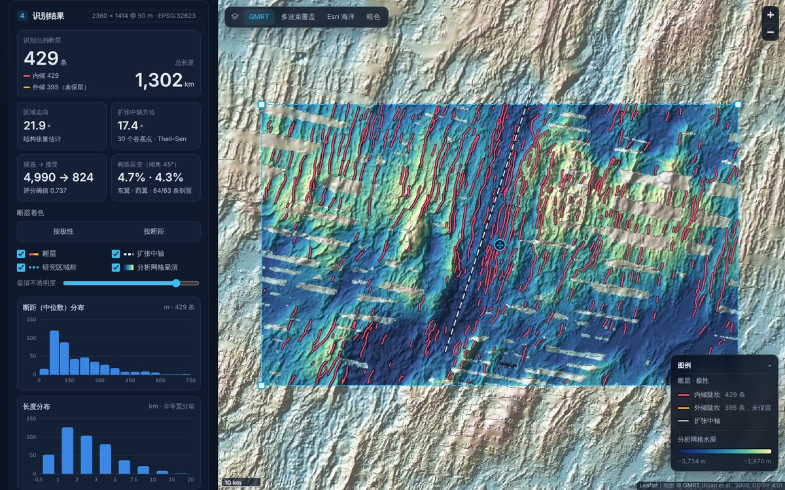

# GMRT_Fault：GMRT 海底正断层自动识别

输入 [GMRT](https://www.gmrt.org)（Global Multi-Resolution Topography）多波束测深，自动识别海底正断层陡坎，
输出断层迹线、断距、朝向、内倾 / 外倾极性和构造应变。仓库只包含三部分：

| 部分 | 作用 |
|---|---|
| [`GMRT_fault_development.ipynb`](GMRT_fault_development.ipynb) | **开发 / 研究笔记本**：研究具体这组数据，用统计和机器学习得出核心参数；最后一步逐项输出每个参数，并可选导出一份**数据传递文件** |
| [`GMRT_fault_implementation.ipynb`](GMRT_fault_implementation.ipynb) | **实现笔记本**：下载 GMRT → 前置处理 → 核心识别 → 输出 GeoJSON / CSV；参数由研究员从开发笔记本**手动抄写** |
| [`docs/`](docs/) | **网页版（PWA）**：实现笔记本改写成的 Python 脚本，用 Pyodide 在浏览器里运行；地图交互，参数可以**上传数据传递文件**或**手动填写** |

```
开发笔记本 ── 第 14 步打印参数 ──（研究员手动抄写）──► 实现笔记本第 5 步
    │                                                  （网页版的内置参数就是同一组数值：docs/py/gmrt_fault_detect.py 第 5 步）
    └── 第 16 步导出数据传递文件 gmrt_fault_params_<区域名>.json ──► 网页版「识别参数 → 上传文件」
                                                                      （或者在「手动填写」里逐项输入）
```

两个笔记本各自独立，彼此不读写任何文件；都不使用 `def`、`class`、`lambda`，按步骤从上到下像瀑布一样摊开。
示例区域是大西洋中脊 29°N（Broken Spur 段），与 CD99 航次 TOBI 深拖侧扫声呐的覆盖区重合，侧扫作为独立观测用来检验参数。



## 1. 网页版（PWA）

部署到 GitHub Pages 后的地址：**https://yuanzhao321.github.io/GMRT_Fault/**（需要先按下面的步骤开启 Pages）。
所有计算都在用户的浏览器里完成，没有服务器。

* **后端就是实现笔记本**：[`docs/py/gmrt_fault_detect.py`](docs/py/gmrt_fault_detect.py) 是实现笔记本逐格改写的 Python 脚本，步骤 0–17 一一对应，同样不定义函数或类。
  网页在 Web Worker 里用 [Pyodide](https://pyodide.org) 314.0.7（编译成 WebAssembly 的 CPython 3.14 + numpy / scipy / pyproj）原样运行它。
* **地图**：拖动 / 缩放；底图可选 GMRT 彩色晕渲、**GMRT 多波束覆盖**（只亮显船测多波束数据，断层只能在这些地方识别）、Esri 海洋、Esri 深灰。
* **研究区域**：输入北 / 南 / 西 / 东四边经纬度，或在地图上框选、拖动角点和中心手柄、用当前视图；实时向 GMRT 查询下载量和网格大小。
* **识别参数（数据导入接口）**，三个选项卡：
  * **常用**：接受规则方案（ML 评分器 / 统计 FDR）、评分阈值、最短长度、是否保留外倾陡坎；
  * **手动填写**：全部 26 个参数逐项输入（按开发笔记本的步骤分组，评分器的 9 个特征及其均值、尺度、系数单独成表），即时校验，圆点标出改过的项；
  * **上传文件**：拖入或选择开发笔记本第 16 步导出的数据传递文件（`.json`），也接受第 14 步打印的参数块（`.py` / `.txt`）或直接粘贴文本。导入后显示来源、数据集和研究诊断，并可一键改用这组参数对应的研究区域。

  参数卡片顶部始终显示当前参数的来源（内置 / 已导入 / 已手动修改几项），可以**导出参数文件**（与笔记本导出的格式相同）、撤销修改或恢复内置参数。
* **运行**：16 个步骤的进度和用时、运行日志、可随时取消；只改了第 14 步以后用到的参数（评分器、接受规则、外倾）时，自动复用第 1–13 步，几秒内重算完。
* **结果**：断层按极性或断距着色标注在地图上（点击查看属性），叠加扩张中轴和分析网格晕渲；统计卡片、断距和长度直方图、走向玫瑰图、可排序的断层列表；下载 GeoJSON / CSV / 摘要 JSON / 晕渲 PNG。
* **离线**：Service Worker 缓存页面和 Pyodide，计算线程缓存下载过的 GMRT 网格；用过一次以后断网也能打开并对同一区域重新计算。

在 MAR 29°N（无头 Chromium 实测）：首次加载 Python 引擎约 28 MB（之后走缓存），下载 GMRT 11.3 MB，计算约 27 s，共约 1 分钟；
内置参数与上传 `docs/params/gmrt_fault_params_mar29n.json` 的结果相同，也与实现笔记本完全一致（4990 条候选 → 824 → **429 条断层，1302 km**）。
计算时峰值内存约 0.6 GB；浏览器版把分析网格限制在 800 万像元以内。

**开启 GitHub Pages**：仓库 Settings → Pages → Build and deployment → Source 选 *Deploy from a branch*，
Branch 选 `claude/mar-fault-detection`（合并后选 `main`）、文件夹选 `/docs`，保存。约一分钟后即可访问（`docs/.nojekyll` 已关闭 Jekyll）。

**本地预览**：`python -m http.server 8000 --directory docs`，然后打开 http://localhost:8000（Service Worker 需要 `localhost` 或 HTTPS）。

**桌面运行同一个脚本**（需要 numpy、scipy、tifffile、pyproj）：

```bash
python docs/py/gmrt_fault_detect.py                               # MAR 29°N，结果写到 py_output/mar29n/
python docs/py/gmrt_fault_detect.py -43.3 -42.95 28.9 29.15 max   # 自定义区域：西 东 南 北 [分辨率]
```

| 文件 | 作用 |
|---|---|
| `docs/index.html`、`css/app.css`、`js/app.js` | 页面：地图、区域选择、参数、进度、结果 |
| `docs/js/params.js` | 26 个参数的说明与校验；解析数据传递文件（JSON）和 Python 参数块（只认字面量，不执行代码）；导出 |
| `docs/js/worker.js` | 计算线程：加载 Pyodide，带进度下载 GMRT，把 GeoTIFF 写进虚拟文件系统，运行脚本并读回结果 |
| `docs/py/gmrt_fault_detect.py` | 识别脚本（实现笔记本的 Python 版） |
| `docs/params/gmrt_fault_params_mar29n.json` | 开发笔记本在 MAR 29°N 上导出的数据传递文件（示例） |
| `docs/sw.js`、`manifest.webmanifest`、`icons/` | PWA：离线缓存、安装 |
| `docs/vendor/` | Leaflet 1.9.4、tifffile 2026.10.15 wheel（随网页分发，各附许可证） |

## 2. 两个笔记本

```bash
pip install -r requirements.txt
jupyter lab      # 依次打开两个笔记本，从上到下运行
```

### 开发 / 研究笔记本（约 3 min，含 TOBI 检验）

| 步骤 | 内容 |
|---|---|
| 0–4 | 配置；下载 GMRT（`topo` + `topo-mask`）、读取、重投影到 UTM、调理（与实现笔记本相同，独立运行） |
| 5 | 数据特征：功率谱与有效分辨率、白噪声、坡度和纹理方向 |
| 6 | 尺度选择：脊线坡度双高斯混合的双峰程度（Ashman D） |
| 7 | 坡度阈值：混合模型后验 |
| 8 | 零假设：相位随机化替代地形 |
| 9 | 在真实网格和替代地形上运行识别流水线（与实现笔记本第 6–13 步相同的代码） |
| 10 | 统计标定：target-decoy 错误发现率（FDR）控制 |
| 11 | 哪些特征能区分真实地形与替代地形 |
| 12–13 | 机器学习：target-decoy 逻辑回归（交叉验证）与按 FDR 选阈值 |
| 14 | **给实现笔记本手动抄写的参数**（打印成可以直接复制的代码） |
| 15 | （仅 MAR 29°N）用 CD99 TOBI 侧扫做独立检验，决定 `KEEP_OUTWARD` |
| 16 | **数据导出**：逐项输出每个参数（数值、单位、来源步骤）；`EXPORT_TRANSFER_FILE = True` 时导出数据传递文件 `gmrt_fault_params_<区域名>.json` |

第 16 步导出的数值与第 14 步打印的数值**逐位相同**（同样的有效数字），所以网页上传这个文件，与研究员手动抄写进实现笔记本的结果一致。
`KEEP_OUTWARD` 的规则：只有当外倾陡坎的精确度代理高出随机水平的部分，至少达到内倾陡坎的一半时才保留外倾陡坎；没有做第 15 步时不做外倾筛选。

### 实现笔记本（约 25 s）

下载 GMRT → 读取 → 重投影 → 调理 → **第 5 步核心参数（手动抄写）** → 导数 → 候选 → 断距 → 骨架 → 路径 → 分段 → 连接 → 特征 → 评分与接受 → 中轴与极性 → 应变 → 输出（`nb_output/<区域名>/faults.geojson`、`faults.csv` 和图）。
换区域时：先运行开发笔记本，再把第 14 步打印的数值抄到实现笔记本第 5 步（网页版则上传第 16 步导出的文件）。

## 3. 数据传递文件

开发笔记本第 16 步和网页版「导出参数文件」写出的都是同一种 JSON：

```json
{
  "format": "gmrt-fault-params",
  "format_version": 1,
  "created_utc": "2026-11-05T21:34:46Z",
  "producer": "GMRT_fault_development.ipynb",
  "dataset": { "aoi_name": "mar29n", "bbox": [-43.75, -42.55, 28.74, 29.36], "gmrt_res": "max", "epsg": 32623, "pixel_m": 50.0, "grid": [2360, 1414] },
  "params": { "SIGMA_M": 75.0, "ORIENT_TOL_DEG": 45.0, "SLOPE_HIGH_DEG": 12.35, "...": "共 26 个，名称与实现文件第 5 步相同" },
  "alternatives": { "stats_fdr": { "MIN_LENGTH_M": 3250.0, "MIN_THROW_M": 10.0, "MAX_STRIKE_DEV_DEG": 45.0, "USE_SCORER": false } },
  "units": { "SIGMA_M": "m", "...": "..." },
  "notes": { "SIGMA_M": "步骤 6：尺度选择（脊线坡度双峰程度 Ashman D 最大）", "...": "..." },
  "diagnostics": { "effective_resolution_m": 600.0, "ml": { "cv_auc": 0.721, "estimated_fdr": 0.10 }, "tobi_check": { "...": "..." } }
}
```

* 网页只读取 `params`（必需）、`alternatives.stats_fdr`、`dataset` 和 `diagnostics`；缺少的参数沿用内置值并给出提示，不认识的字段会被忽略。
* 也可以上传 / 粘贴只含 `{"SIGMA_M": 75.0, ...}` 的 JSON，或开发笔记本第 14 步打印的参数块（`SIGMA_M = 75.0` 这样的 Python 赋值，`# 备选：…` 后面被注释掉的一行作为统计 FDR 方案）。

## 4. MAR 29°N 的结果

* 研究得出的参数：尺度 75 m，朝向容差 45°，坡度阈值 12.35° / 8.82° / 6.82°；target-decoy 逻辑回归评分器（9 个形态特征，交叉验证 AUC 0.721），按估计 FDR 0.10 选出阈值 0.736845；统计 FDR 备选方案为最短 3.25 km、断距 ≥ 10 m、走向偏离 ≤ 45°。
* TOBI 独立检验（第 15 步，机器学习参数组）：内倾陡坎的精确度代理 0.262（随机 0.122），外倾陡坎 0.096（随机 0.147），外倾陡坎大多不是断层，因此 `KEEP_OUTWARD = False`。
* 识别结果：区域走向 21.9°；4990 条候选 → 评分器接受 824 条（2236 km），其中内倾 429 条、外倾 395 条；保留内倾 **429 条断层，共 1302 km**；扩张中轴方位 17.4°（30 个谷底点）；45° 倾角下构造应变东翼 4.7%、西翼 4.3%。

## 5. 局限性

* 能检测到的最小断层由数据的**有效分辨率**决定，而不是节点间距。GMRT MAR 29°N 的有效分辨率约 600 m，断距小于约 100 m 的断层大多检不出来。
* GMRT 的拼接缝（不同航次数据的边界）可能产生直线状的假陡坎；与走向夹角大时会被方向约束过滤掉，与走向接近时无法排除。
* 只用测深无法区分真正的外倾断层与掀斜断块的背坡或火山脊的翼部。
* 参数是针对具体数据集研究出来的；换区域时应先用开发笔记本重新研究，再导入网页或抄写进实现笔记本。没有中央裂谷的区域，自动拟合的中轴意义不大，应保留外倾陡坎。
* 中轴采用直线模型，不适用于段的末端和非转换断错附近。
* 浏览器版受内存限制，分析网格最多 800 万像元。

## 6. 目录结构

```
GMRT_fault_development.ipynb    开发 / 研究笔记本（第 16 步导出数据传递文件）
GMRT_fault_implementation.ipynb 实现笔记本（第 5 步参数手动抄写）
requirements.txt                运行两个笔记本所需的包
docs/                           网页版（PWA，GitHub Pages 从这里发布）
  index.html  css/  js/app.js  js/params.js  js/worker.js
  py/gmrt_fault_detect.py       实现笔记本的 Python 版（网页的计算后端，也可在桌面运行）
  params/                       示例数据传递文件
  sw.js  manifest.webmanifest  icons/  vendor/
data/                           （不入库）笔记本下载的 GMRT 网格、CD99 TOBI 侧扫
nb_output/  py_output/          （不入库）运行输出
```

## 7. 数据引用与参考文献

* GMRT（CC BY 4.0）：Ryan, W.B.F., et al. (2009), Global Multi-Resolution Topography synthesis, *G³* 10, Q03014, doi:10.1029/2008GC002332。本例使用 GMRT 4.5.0。
* CD99（CC BY 4.0）：Escartin J., Mitchell N., Searle R., Cowie P. (2026). *RRS Charles Darwin cruise 99 geophysical data from the Mid-Atlantic Ridge 29˚N collected in 1996.* SEANOE. https://doi.org/10.17882/120030
* Escartín J. et al. (1999). Quantifying tectonic strain and magmatic accretion at a slow spreading ridge segment, Mid-Atlantic Ridge, 29°N. *JGR* 104(B5), 10421–10437. doi:10.1029/1998JB900097
* Searle R. C. et al. (1998). Fault structure and detailed evolution of a slow spreading ridge segment: the Mid-Atlantic Ridge at 29°N. *EPSL* 154, 167–183. doi:10.1016/S0012-821X(97)00160-X
* Käll L. et al. (2007). Semi-supervised learning for peptide identification from shotgun proteomics datasets (Percolator). *Nature Methods* 4, 923–925（target-decoy 思路的来源）。
* 网页版使用 Pyodide 314.0.7（MPL-2.0）、Leaflet 1.9.4（BSD-2-Clause）、tifffile（BSD-3-Clause）；底图来自 GMRT WMS 和 Esri。
